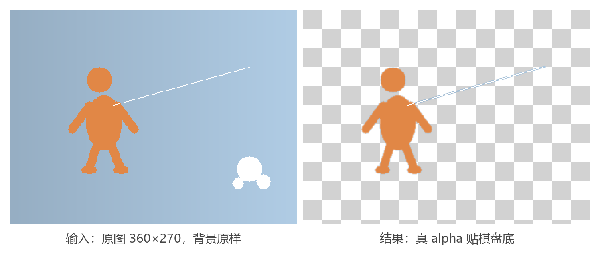
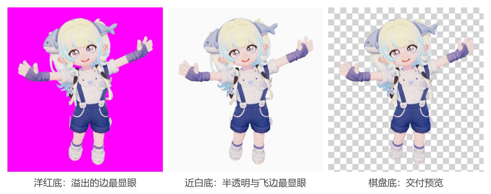

# cutout-evidence-matte

## 它解决什么，和生成式抠图有什么不同

生成式模型交回来的是一张**重绘图**，不是原图的像素：边缘发脏、1px 细线在重绘里断掉、
深浅两版素材对不上。这个工具只让模型投票「保留哪些东西」——谁在前、哪些该排除、哪些算细结构——
像素永远从原图取，边界 alpha 在本地按颜色线估，所以 `pixel_fidelity` 恒为 0。判据过不了它不交
一张「看着差不多」的图，而是报 `uncertain` 并写明缺的是哪一层（P1 / P2 / P3 / 几何 / alpha）。



同一张合成 demo：左边是进什么（原图 360×270，蓝渐变底 + 橙色人形 + 1px 白线 + 一团要排除的白水花），
右边是出什么（真 alpha 贴棋盘底）——背景和水花没了，1px 白线还在，边缘不是二值硬切。

## 真实一张图上的实测



同一张**已经抠出的角色**贴到三种底上：脏边看洋红、半透明与飞边看近白、交付预览看棋盘。
这张图上 `halo 17.301`、`coverage 0.9874`、`pixel_fidelity 0`，能判的都过了、`status=pass`
（这张图没有细结构、也没有人工参照，`continuity` / `iou_ref` 不参与判定）。首跑记的是
`halo 18.186`、`coverage 0.9888`，上面两个数是按当前规则重跑的，图与数字取自同一次运行。
图里只有抠出的角色与纯色/棋盘底，原图场景与 UI、以及任何新素材都不进这个仓库。

这是一个可独立运行的 Skill 包，也是它的 GitHub 仓库根目录。`SKILL.md` 是给 Agent 的使用说明；
本文件说明怎么装、怎么验证、出问题看哪里。

## 30 秒验证（完全离线）

```bash
pip install -r requirements.txt        # numpy, opencv-python
python scripts/selfcheck.py
```

预期输出包含六项指标与 pass：

```
== 1. thresholds vs docs/thresholds.md ==
  ok: 12 numeric thresholds + p1_leak rule match; attribution table and uncertain rules U1/U2/U3 present
== 2. offline demo ==
  case: demo-scene
  halo            = 10.446
  stray           = 0
  hole            = 0.0
  coverage        = 0.9994
  continuity      = 1.0
  pixel_fidelity  = 0
  status = pass   score = 10.5302   blocked_layer = None
SELFCHECK: PASS
```

退出码 0 = demo 通过；1 = 跑通但判 `uncertain`（看 scorecard）；2 = 缺依赖、demo 缺件或
判据与文档不一致。全程不发网络请求，也不需要任何 key。

demo 就是上面第一张图：一张原图 + 三份手写产物。`demo/cache/demo-scene/auto/` 里的 `bria.png`（P1）、
`key.png`（P3）、`layers/*.png`（P2）由 `scripts/make_demo.py` 用 numpy/OpenCV 直接画出，
用来证明决策层不依赖某个采集服务，也不是回放件。重新生成：`python scripts/make_demo.py`。

## 用自己的图

1. 建一个 case 目录，放原图与 `case.json`：

```json
{"id": "my-case", "source": "source.png",
 "keep": ["角色", "细线"], "exclude": ["水花"], "thin": ["细线"]}
```

2. 准备三路候选产物（任意去背景 / 图层拆分 / 绿幕编辑工具，或手工做），按契约放到
   `<cache-root>/my-case/auto/`：

```
meta.json        # bria / key / layers[]，bbox 用原图坐标
bria.png         # P1 显著性去背景（RGBA）
key.png          # P3 绿幕图（RGB，纯 #00FF00 底）
layers/*.png     # P2 图层（RGBA，每层一张，label 写清是什么）
```

3. 校验并运行：

```bash
python scripts/cutout_run.py check-cache --case <case-dir> --cache-dir <cache-root> --strict
python scripts/cutout_run.py run --case <case-dir> --cache-dir <cache-root> --out out
```

产出 `out/<case>.rgba.png`、`.mask.png`、`.scorecard.json`、`.recipe.json`、`.proof.png`。
`status=uncertain` 时看 `failures` 与 `blocked_layer`，按 `docs/thresholds.md` 的归因表动那一层。
上面第二张图就是用这条命令跑出来的一份真产物（贴底合成后裁到角色）。

## 为什么效果取决于三路产物

决策层不会替你猜范围。它只拿 P1（显著性去背景）、P2（图层拆分）、P3（绿幕编辑）三路证据做
融合：P1 只说「最显眼的是这块」，P2 说「这块归谁、这块不是主体」，P3 只在主体整体缺失时补位。
要保留什么、要排除什么、边界在哪，几乎全由 P2 回答；换一个弱的分层工具，文件契约一样能过，
抠出来的范围却会明显变差。所以三路不是可以随便替换的：先跑 `check-cache --strict`，P2 不够用时
它不会静默放过，而是退出码非 0 并点名 P2。

```bash
python scripts/cutout_run.py check-cache --case demo --cache-dir demo/cache --strict
```

## 目录

| 路径 | 内容 |
| --- | --- |
| `SKILL.md` | Agent 入口：方法、五条规则、采集契约、判据与失败模式 |
| `docs/thresholds.md` | 12 条数值阈值 + p1_leak 规则、规则参数、归因表、uncertain 口径 U1/U2/U3 |
| `docs/images/` | 本文件那两张图：demo 前后对比、真实案例三联 |
| `scripts/cutoutlib/` | 唯一实现：融合、几何先验、颜色线 matting、背景色模型、评分 |
| `scripts/selfcheck.py` | 判据比对 + 离线 demo 一条命令自检 |
| `scripts/cutout_run.py` | `check-cache` / `run` 两个子命令 |
| `scripts/make_demo.py` | 重新生成 demo 的原图与三份手写产物 |
| `demo/` | 离线样例：原图、`case.json`、手写缓存 |

## 依赖

- 必需：`numpy`、`opencv-python`（`pip install -r requirements.txt`）
- 不需要：`scipy`、`Pillow`（代码里不 import）；GPU、本地大模型、任何云端调用都不需要

缺库时 `selfcheck.py` / `cutout_run.py` 会打印缺的是哪个包和安装命令，不会只丢一个 ImportError。

## 失败模式

| 现象 | 原因 | 处理 |
| --- | --- | --- |
| `缺 P1 / P2 / P3` | 缓存少某一路 | 按提示补 `bria.png` / `layers/*.png` / `key.png`，并检查 `meta.json` 对应字段 |
| `P2 图层 bbox 无效` | bbox 不是原图坐标或为空 | 改成 `[x0,y0,x1,y1]`（原图坐标） |
| `strict FAIL -> weak leg: P2` | 文件齐全，但 P2 层数 / label / keep 覆盖率至少两条不过 | 按 SKILL.md「怎么产出三路候选」重做 P2，不要改阈值绕过 |
| `unresolved_keep` | keep 项在原图定位不到 | 图里没有就改 keep；有但漏了按归因补提案 |
| `status=uncertain` | 某条判据未过 | 看 `failures` / `blocked_layer`，按归因表改那一层，不要调阈值 |
| 边缘糊、主体被重绘 | 把生成图当成了结果 | 最终像素必须来自原图，模型只给候选 mask |
| 主体里的真实缝隙被填上 | 洞的判定把「看穿」当成「漏抠」 | 调 `hole_max_fill_frac`（见 `docs/thresholds.md` 的规则参数），不是调阈值 |

## 边界

阈值是冻结的标定结果，不是可调默认值。`selfcheck.py` 会逐条比对 `docs/thresholds.md` 与
`scripts/cutoutlib/score.py`，任何一边单方面改动都会当场失败。改阈值必须重新标定并同时更新两处。

真实案例与手写 demo 走同一条命令；demo 只是最小可复现样本，不代表真实题材一定通过——
过不了时它会明确报 `uncertain`，不会静默交一张错的图。
